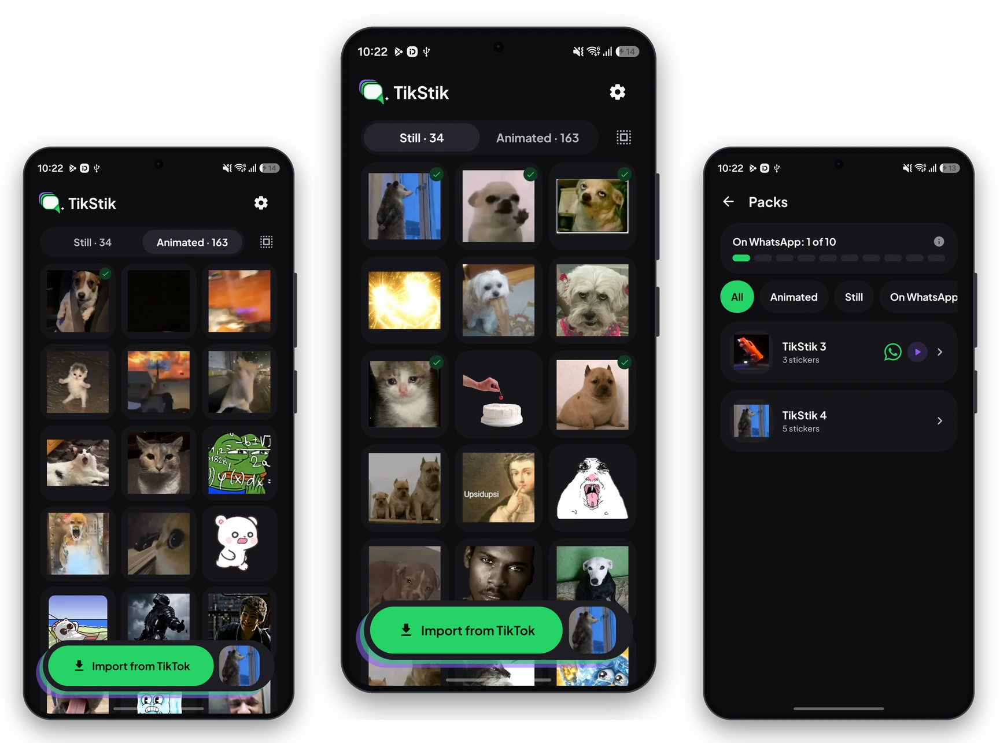
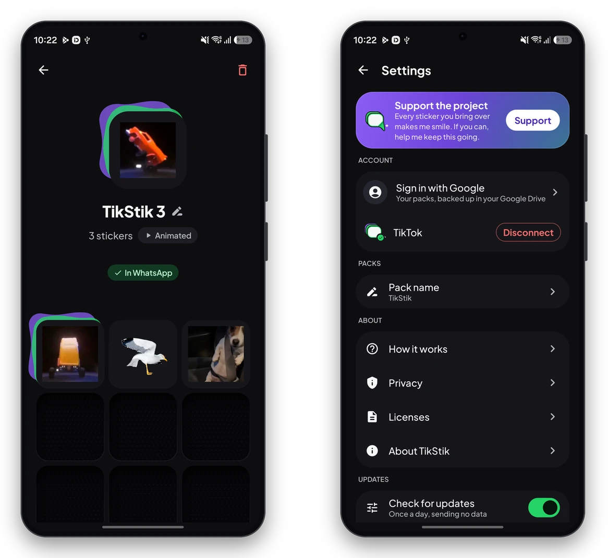

<div align="center">

<picture>
  <source media="(prefers-color-scheme: dark)" srcset=".github/readme/logo-dark.svg">
  
</picture>

### Your TikTok stickers, on WhatsApp.

Save them on TikTok. Use them on WhatsApp. Free, open source, no account and no ads.

[](https://github.com/redrixDev/TikStik/releases/latest)
[](#download)
[](LICENSE)
[](https://ko-fi.com/redrixdev)
[](https://github.com/sponsors/redrixDev)

<a href="https://github.com/redrixDev/TikStik/releases/latest"></a>

<br>



<sub>Not affiliated with TikTok or WhatsApp.</sub>

</div>

---

## What it does

- **Imports the stickers you saw or saved on TikTok**, still and animated, straight from your phone.
- **Keeps them in your own collection**, sorted by what you saw last, so the new ones are always on top.
- **Turns them into WhatsApp packs** of 3 to 30 stickers, and adds them to WhatsApp or WhatsApp Business with one tap.
- **Keeps the packs in sync**: rename, reorder or add stickers, and WhatsApp gets the change.
- **Optional backup to your own Google Drive**, so your packs come back on a new phone.
- **Updates from inside the app**: it tells you when there is a new version and installs it with Android's installer.
- **Nothing goes to any server of ours.** There are none.

## How it works

TikTok keeps the stickers you have seen in its image cache. Android does not let one app read another app's files, so TikStik uses a door Android leaves open on purpose: **wireless debugging**, the same tool developers use to talk to a phone over Wi-Fi.

1. **Connect once.** Turn on developer options and wireless debugging, and pair TikStik with your phone by typing the six-digit code Android shows you. The app walks you through every step.
2. **Import.** TikStik connects to your own phone over the local network, reads TikTok's cache and shows the stickers it found. You choose which ones to keep. Wireless debugging is turned on only while importing, and off again afterwards.
3. **Make packs.** Pick stickers of the same kind and send the pack to WhatsApp. TikStik converts each one to what WhatsApp requires: 512×512 WebP within its size limits.

On Android 8 to 10 the cache can be read directly, so TikStik only asks for the storage permission.

<div align="center">

</div>

## Privacy

- Your stickers stay on your phone. TikStik has no servers.
- When importing, it looks at TikTok's cache only to find your stickers.
- If you sign in with Google, your packs go to a private folder of **your** Google Drive (`appDataFolder`) that only TikStik can see.
- At most once a day it asks GitHub whether there is a new version, sending no data. You can turn it off in Settings.
- No analytics, no crash reports, no identifiers, no ads.

The full policy is in [PRIVACY.md](PRIVACY.md).

## Download

Get the APK from **[GitHub Releases](https://github.com/redrixDev/TikStik/releases/latest)** and open it on your phone. The first time, Android asks you to allow installing apps from your browser or file manager.

- **Requires** Android 8.0 or newer. Wireless debugging, used on Android 11 and newer, needs Wi-Fi.
- **Updates** install over the previous version only when the signature matches, so your stickers and packs stay.

## Support the project

TikStik is free and will stay free, with no ads. If it is useful to you, you can help keep it going:

<a href="https://ko-fi.com/redrixdev"></a>
<a href="https://github.com/sponsors/redrixDev"></a>

## Build it yourself

You need Android Studio, or the Android SDK with NDK 28.2.13676358 and CMake 3.22.1, and a JDK 17 or newer.

```bash
git clone https://github.com/redrixDev/TikStik.git
cd TikStik
./gradlew :app:assembleDebug
```

The debug build installs as `com.redrixdev.tikstik.debug` and works without any configuration. For a release build, add your own signing key to `local.properties` (the four properties are in `app/build.gradle.kts`); without them the release APK is produced unsigned.

<details>
<summary><b>Tests and project notes</b></summary>

<br>

```bash
./gradlew :app:testDebugUnitTest :app:lintDebug
```

- Instrumented tests run on an emulator with `./gradlew :app:connectedDebugAndroidTest`.
- The in-app list of third-party licenses is generated with AboutLibraries. After changing dependencies, run `./gradlew :app:exportLibraryDefinitions`.
- A GitHub release is offered to the app when its tag carries the version number (`v1.2.3`) and a single `.apk` is attached.

</details>

## License

TikStik is free software: you can redistribute it and/or modify it under the terms of the GNU General Public License as published by the Free Software Foundation, either version 3 of the License, or (at your option) any later version. See [LICENSE](LICENSE).

<details>
<summary><b>Additional permission for Google Play services</b></summary>

<br>

The optional Google Drive backup uses the Google Play services client libraries (`com.google.android.gms`), which are covered by the Android Software Development Kit License, not by a GPL-compatible license. So that TikStik and modified versions of it can be distributed with them, the licensors of TikStik grant this additional permission under section 7 of the GNU GPL version 3 (the [GPL-3.0 linking exception](https://spdx.org/licenses/GPL-3.0-linking-exception.html) template):

> If you modify this Program, or any covered work, by linking or combining it with Google Play services (or a modified version of that library), containing parts covered by the terms of the Android Software Development Kit License, the licensors of this Program grant you additional permission to convey the resulting work.

</details>

Third-party code and assets keep their own licenses; see [THIRD_PARTY.md](THIRD_PARTY.md). In particular, `spake2-android` is LGPL-3.0 and is kept as an unmodified, replaceable library, and parts of `libadb-android` are BSD-3-Clause.

**Trademark notice.** The name **TikStik**, its logo and icons are not covered by the GPL. All rights reserved. If you distribute a modified version of this app, give it a different name and logo so that users are not confused about where it comes from.

<div align="center">
<br>
<sub>Made by <a href="https://github.com/redrixDev">redrixDev</a> · TikTok and WhatsApp are trademarks of their respective owners.</sub>
</div>
